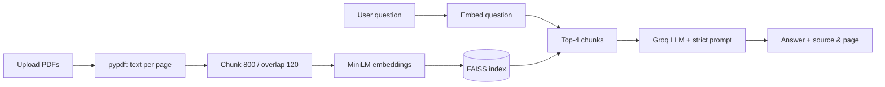

# Domain-Specific RAG Chatbot for PDF Question Answering

Upload PDFs (policies, manuals, notes…) and ask questions in natural language. The app retrieves the
most relevant passages and answers **only from them**, showing the source document and page.

## Workflow



## Files

| File | Role |
|---|---|
| `app.py` | Streamlit UI (uploader, Process button, chat, sources, Clear Chat) |
| `document_loader.py` | File validation, page extraction (with metadata), chunking |
| `vector_store.py` | Embeddings (`all-MiniLM-L6-v2`) and FAISS build/save/load |
| `rag_pipeline.py` | Retrieval and grounded answer generation (Groq) |
| `prompt.py` | Guardrail prompt and fallback message |
| `tests/test_questions.csv` | Evaluation sheet (15 questions) |

## Setup

```bash
python3 -m venv .venv && source .venv/bin/activate   # use Python 3.10–3.12 for best wheel support
pip install -r requirements.txt
cp .env.example .env        # then put your GROQ_API_KEY in .env
streamlit run app.py
```

Put sample PDFs in `documents/`, upload them in the sidebar, click **Process Documents**, then ask questions.

## Safety

- API keys live in `.env` (git-ignored); never commit them.
- Only `.pdf` files up to 20 MB are accepted.
- The prompt tells the model to ignore instructions embedded in documents and to refuse when the
  answer is not in the context. Answers can still be wrong — verify high-stakes information.
- Scanned PDFs have no text layer and are skipped (OCR is an optional extension).

## Testing

Fill in `tests/test_questions.csv` with your own documents: record the retrieved source/page,
whether the answer was correct and grounded, and whether unavailable questions were refused.

## Deployment

Push to GitHub and deploy on Streamlit Cloud (set `GROQ_API_KEY` under Secrets) or Render/Docker.
